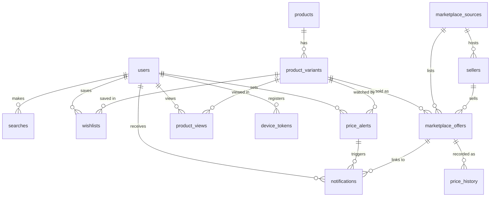

# Database Design (PostgreSQL 16)

Migrations: `backend/alembic/versions/` (Alembic). `alembic upgrade head` runs automatically when
the API container starts. A test (`test_models_and_migrations_do_not_drift`) fails if the ORM models
and the migrations diverge.

## ERD

## Tables
| Table | Purpose | Notable columns / constraints |
|-------|---------|-------------------------------|
| `users` | Family members | `token_hash` (SHA-256 of API token, unique) |
| `marketplace_sources` | Shopee / Lazada / TikTok Shop, separately for mock and live | unique `(code, is_mock)` |
| `sellers` | Shop on a marketplace | unique `(source_id, external_id)`; `is_official_store` = the marketplace's own label |
| `products` | Canonical product (brand + model/line), marketplace independent | `product_key` unique; indexes on `brand`, `category` |
| `product_variants` | Purchasable variant (volume, size, colour, pack, origin, condition…) | `variant_key` unique; `attributes` JSONB (`ProductAttributes`); `search_query` used by the price monitor |
| `marketplace_offers` | One listing of one variant | unique `(source_id, external_id)` — the marketplace's own listing id; original `url`; `raw` JSONB as retrieved; `price` JSONB breakdown; `final_price` NULL when incomplete; `retrieved_at`; `is_mock`; index `(variant_id, final_price)` |
| `price_history` | Price of **one offer** over time | index `(offer_id, recorded_at)`; a row is added when the price changes or ≥ 1 h has passed |
| `searches` | Search history | `search_type` text/image/url, `spec` JSONB; index `(user_id, created_at)` |
| `product_views` | Recently viewed | unique `(user_id, variant_id)` |
| `wishlists` | Saved variants | unique `(user_id, variant_id)`; `current_lowest_price`, `previous_lowest_price`, `last_checked_at` |
| `price_alerts` | Target price per saved variant | unique `(user_id, variant_id)`; `last_notified_price` for de-duplication |
| `notifications` | Notification history | `dedupe_key` unique; `status` pending → pushed / in_app / failed; `read_at`; `is_mock` |
| `device_tokens` | FCM device tokens | `token` unique |

All foreign keys cascade on delete except notifications' links (SET NULL) so history survives.

## Relationship rules (from the spec)
* one canonical product → many variants; one variant → many marketplace offers;
* each offer belongs to exactly one marketplace source and one seller and keeps its own listing id and URL;
* price history belongs to an individual offer;
* wishlist items and price alerts reference the variant (and its product).

## pgvector
Not used. Retrieval is keyword search delegated to the marketplaces plus deterministic attribute
matching; with a few thousand stored variants at most there is no nearest-neighbour workload where
embeddings would materially help. Revisit only if "find a cheaper alternative across brands" is built.

## Seed data
There is no fabricated seed inserted into the database. Demo content comes from the labelled mock
catalogue `backend/app/connectors/mock_data/catalog.json` through the mock connectors;
`scripts/seed_demo.sh` runs the six example searches so the tables are populated.

## Backup and recovery
`infrastructure/backup.sh` (gzip `pg_dump`, keeps 14) and `infrastructure/restore.sh` — see
[DEPLOYMENT_GUIDE.md](DEPLOYMENT_GUIDE.md).
