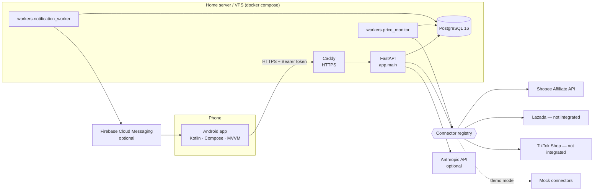
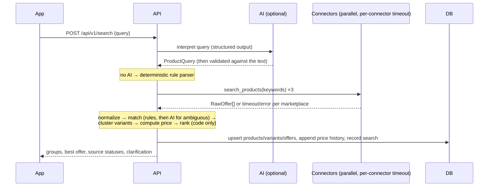

# System Architecture

## Overview

## Search request flow

## Backend layout (`backend/`)
| Path | Responsibility |
|------|----------------|
| `app/api/v1/` | REST routes: search, products, wishlist + price alerts, history, meta (sources, explore, notifications, devices, assistant) |
| `app/core/` | Settings (env), DB session, error envelope, JSON logging, request-id + timeout + rate-limit middleware, token auth |
| `app/schemas/` | `domain.py` (engine types), `api.py` (JSON contract with the app) |
| `app/models/` | SQLAlchemy ORM; schema source of truth is `alembic/versions` |
| `app/repositories/` | Catalogue persistence (products, variants, offers, sellers, price history) |
| `app/services/` | `normalization`, `matching`, `pricing`, `search` (orchestration + ranking), `alerts`, `push`, `url_parser`, `products` |
| `app/connectors/` | `base` interface, `mock`, `shopee_affiliate`, `pending` (Lazada/TikTok), `registry` |
| `app/ai/` | Anthropic client wrapper, query interpreter, image identifier, match judge, assistant |
| `workers/` | `price_monitor.py`, `notification_worker.py` |
| `tests/` | Unit + integration tests, labelled matching dataset |

## Android layout (`android/`)
Kotlin · Jetpack Compose · Material 3 · MVVM + Clean Architecture (`data` / `domain` / `ui`), Hilt,
Coroutines/Flow, Retrofit + kotlinx.serialization, Room (offline cache), DataStore (settings),
WorkManager (notification polling), optional FCM. See `android/README.md` and
[UI_UX_SPECIFICATION.md](UI_UX_SPECIFICATION.md).

## Key design decisions
1. **Deterministic core, AI at the edges.** Matching rules, price maths and ranking are plain,
   tested code. AI interprets language/images and explains; its outputs are schema-validated and
   then checked/clamped by code. The system works without any AI key.
2. **Canonical product model.** `products` → `product_variants` → `marketplace_offers`. Listings are
   clustered into variants by a deterministic "same variant" predicate; a listing that leaves a
   variant attribute unstated is kept apart and labelled `likely`.
3. **Two modes, never mixed.** `DEALMATE_MOCK_MODE=true` → every marketplace is a mock connector and
   every offer/notification carries `is_mock`. `false` → only real connectors; unconfigured ones
   report their status and contribute nothing.
4. **Partial results by design.** Each connector runs in parallel under its own timeout; failures
   become a per-marketplace status in the response.
5. **Private app security model.** Per-user random bearer tokens (only SHA-256 stored), HTTPS via
   Caddy, DB not exposed, secrets only in server environment variables, images processed in memory
   and never stored.
6. **Periodic price checks, not real time.** A worker re-queries saved variants every
   `DEALMATE_PRICE_CHECK_INTERVAL_MINUTES`; every price carries `retrieved_at`.
7. **PostgreSQL only.** No Redis/queue: one family, one API process. The in-memory rate limiter and
   DB-backed notification queue are sufficient and documented as single-instance.

## Milestone 0 findings (development environment)
* Repository was empty. JDK 21 and Gradle 8.14 present; the Android SDK was installed during
  development (platform 35/36, build-tools). No emulator/KVM → Android verification is
  build + JVM/Robolectric tests + rendered screenshots, **not** on-device runs.
* PostgreSQL 16 available locally → backend tests run against a real database.
* Marketplace developer portals were not reachable and no marketplace credentials exist → real
  integrations could not be verified.
* No Anthropic API key in the environment → AI paths are tested with a scripted fake client only.
