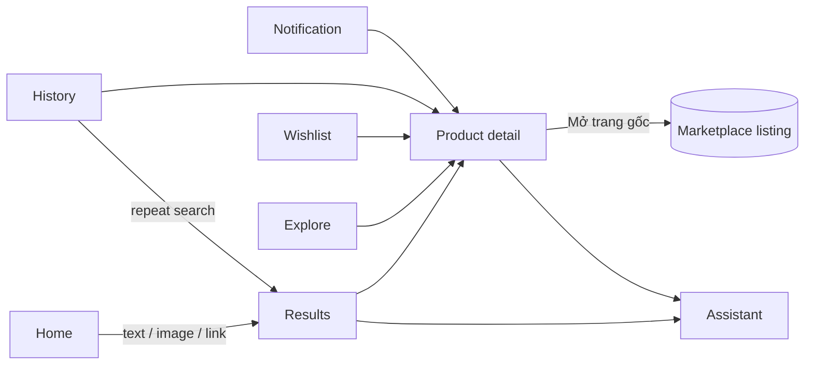

# UI / UX Specification (Android)

Stack: Kotlin, Jetpack Compose, Material 3. Vietnamese by default (`values/`), English available
(`values-en/`). Light and dark themes; dynamic colour is off so the brand accent stays consistent.

## Design direction
* Clean shopping feel: white / warm-neutral surfaces, **orange** primary accent, rounded cards,
  clear type hierarchy, 4 / 8 / 16 dp spacing rhythm.
* Avoided on purpose: heavy gradients, badge clutter, oversized headings, dense tables, decorative
  animation, deep navigation.
* **The cheapest verified offer of the right product is the most prominent element** on the results
  and product screens.

## Navigation
Bottom bar with five destinations — **Trang chủ · Khám phá · Yêu thích · Lịch sử · Cài đặt** — plus
pushed screens: Results, Product detail, AI assistant (sheet).

## Screens
| Screen | Content | States |
|---|---|---|
| Home | Search bar, method selector (Văn bản / Hình ảnh / Link), example queries, category shortcuts (run a search — no products are hard-coded), recent searches, recently viewed, wishlist shortcut | not-connected, loading, empty history |
| Results | Interpreted-query chips (brand, size, budget; rules or AI), per-marketplace source status, **best-offer banner** (price, marketplace, explanation, caveat), "which variant?" suggestion chips, product groups, separate **Sản phẩm tương tự** section, filter/sort sheet | loading, partial (a marketplace failed), empty with advice, error + retry, offline (cached result with hint) |
| Product detail | Title + match label and reason, best offer card, all offers sorted as returned, price breakdown per offer, **price history** chart (titled as history), wishlist button + target-price dialog, "Mở trang gốc", ask-the-assistant | loading, error + retry, no offers |
| Wishlist | Saved items: current lowest price + confidence, previous price with up/down indicator, target price, edit target, remove with undo, pull to refresh | empty, error, offline cache |
| History | Searches with time and type, repeat on tap; viewed products; clear with confirmation | empty, error |
| Explore | Recorded price drops and recently seen products, category and marketplace filters | empty state shows the server's reason — never invented deals |
| Settings | Language, preferred marketplaces, default sort, notifications, delivery location, server URL + token + connection test, data-source status (mock/live, verified, AI, push), about | validation and connection errors |
| Assistant | Question chips + free text; answer, the facts it is based on, disclaimer, "AI" or "quy tắc" origin | loading, error |

## Honesty in the interface
| Situation | Presentation |
|---|---|
| `demo_mode` | Persistent banner "Chế độ demo — dữ liệu mẫu, không phải giá thật"; every mock offer has a **DEMO** tag; mock links (`*.invalid`) open an explanatory dialog instead of a browser |
| `price.confidence = verified` | "Đã xác minh" |
| `estimated` | "Ước tính" + the notes (conditional voucher, estimated shipping) |
| `incomplete` | "Thiếu phí vận chuyển": shows the known part as "chưa gồm phí vận chuyển"; never labelled cheapest |
| `match_type` | exact → "Đúng sản phẩm"; likely → "Có thể đúng — thiếu thông tin"; similar → "Sản phẩm tương tự" (separate section); always with the reason |
| `is_stale` | "Dữ liệu cũ" hint next to the relative retrieval time |
| `seller.is_official_store` | Shown only when true, worded as the marketplace's label; the app never says "chính hãng" on its own |
| Marketplace identity | Coloured initial chips — no marketplace logos/trademarks are copied |

## Reusable components
`DealMateSearchBar`, `SearchMethodSelector`, `ProductCard`, `OfferCard`, `MarketplaceLogo`,
`PriceComparisonSection`, `PriceBadge`, `SellerInformation`, `PriceHistoryChart`, `WishlistButton`,
`SearchFilterSheet`, `ProductImagePicker`, `EmptyState`, `ErrorState`, `DemoBanner`.

## Formatting
Money `315.000đ`; relative times ("5 phút trước"); long Vietnamese titles truncate to two lines.

## Permissions
`INTERNET`; `POST_NOTIFICATIONS` (asked when notifications are enabled, Android 13+); `CAMERA`
(asked only when taking a photo). Gallery access uses the system Photo Picker (no storage permission).

## Verification
Rendered screenshots of the main screens in light and dark are in `android/screenshots/`
(generated by the screenshot tests). The app has not been exercised on a physical device.
